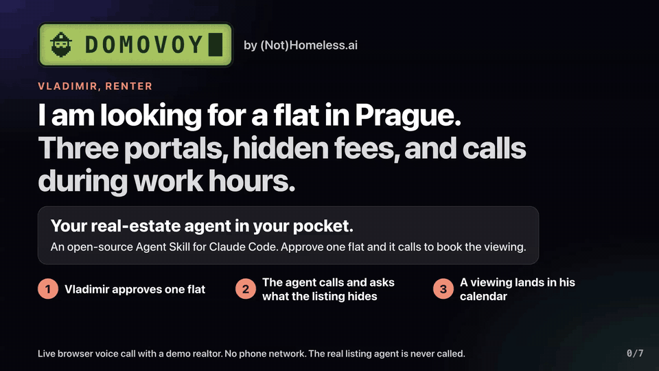
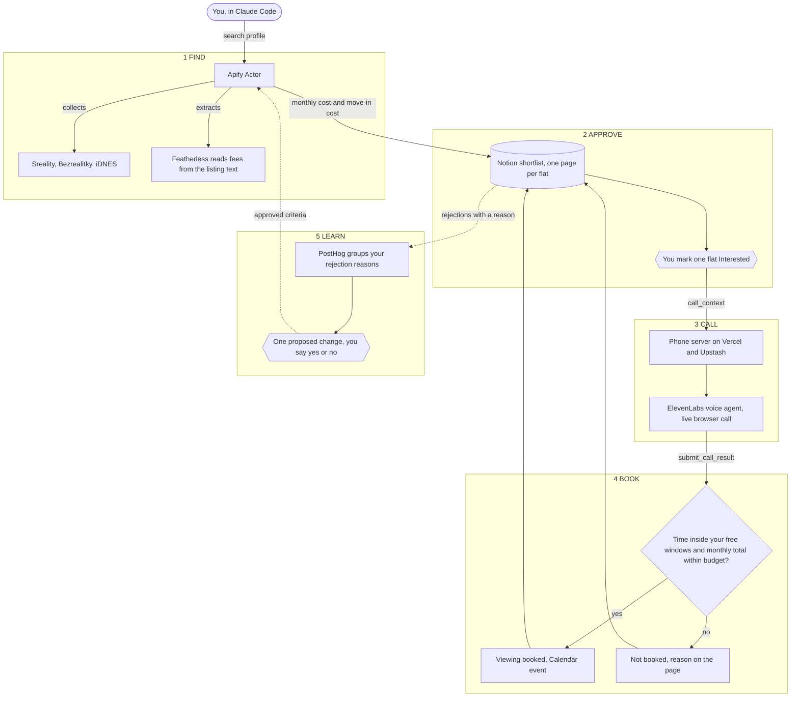
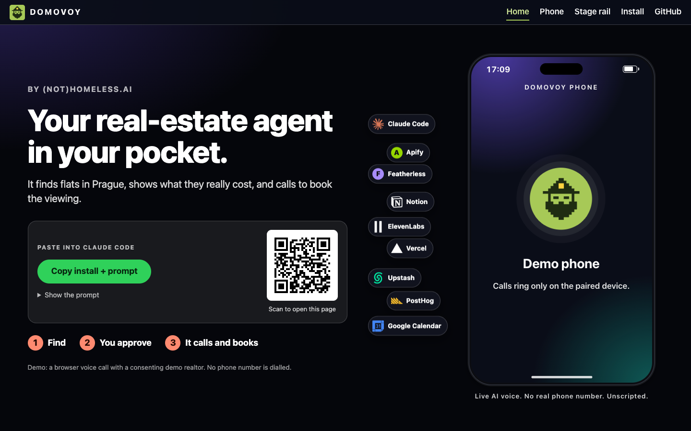

<div align="center">


# DOMOVOY

**Your real-estate agent in your pocket.**

An open-source Agent Skill for Claude Code that finds a flat to rent in Prague,<br>
shows what each flat really costs, and holds a live voice call to book the viewing.

[](skill/domovoy/SKILL.md)
[](docs/demo.md)
[](skill/domovoy/SKILL.md)
[](LICENSE)

[](apify/README.md)
[](apify/README.md#extraction-chain-wp4)
[](docs/plan.md#notion-shortlist)
[](docs/prd/voice.md)
[](phone/README.md)
[](phone/README.md#layout)
[](posthog/README.md)
[](docs/packaging.md#prerequisites)
[](docs/packaging.md#prerequisites)

### [Live page](https://domovoy-phone.vercel.app/start) · [Quick start](#quick-start) · [Docs](docs/README.md) · [Demo plan](docs/demo.md) · [Costs](#costs)

<a href="https://domovoy-phone.vercel.app/stage"></a>

<sub>Screen recording of the public <a href="https://domovoy-phone.vercel.app/stage">stage page</a>, 13 Nov 2026. Synthetic flat, sample data, simulated call states. The panels are labelled stand-ins, not a recording of a live call.</sub>

</div>

---

## Why this exists

- **Listings hide fees.** The deposit, the commission and the utilities sit somewhere in the text, or nowhere.
- **Realtors do not answer email.** You have to call, and they pick up during your work hours.
- **Viewings are gone in a day.** By the time you have compared three portals, the slot is taken.

## Contents

- [Why this exists](#why-this-exists)
- [What it does](#what-it-does)
- [How it works](#how-it-works)
- [A real call](#a-real-call)
- [Quick start](#quick-start)
- [Services](#services)
- [Costs](#costs)
- [Interesting facts](#interesting-facts)
- [Built today, and what we reused](#built-today-and-what-we-reused)
- [Make it yours](#make-it-yours)
- [Roadmap](#roadmap)
- [FAQ](#faq)
- [Repository layout](#repository-layout)
- [Documentation](#documentation)
- [Team](#team)
- [License](#license)

## What it does

Renting in Prague means three portals, fees hidden in the listing text, and calls you have to make during work hours. You tell Claude Code what home you need. DOMOVOY does the rest, and stops for your yes before it contacts anyone.

| You get | How |
| --- | --- |
| One shortlist from three portals | An Apify Actor collects listings from Sreality, Bezrealitky and iDNES and merges the same flat across portals |
| Honest costs | Monthly cost and move-in cost for each flat, with the quote the number came from. An unknown fee stays unknown, never zero |
| A call you do not have to make | A voice agent holds the call and asks what the listing does not say |
| A receipt you can check | Claude rechecks the agreed time and the budget, updates the Notion page and prepares the Calendar event |
| A shortlist that learns | Your rejection reasons become one proposed criteria change, applied only after your yes |

> [!IMPORTANT]
> The call is a live browser voice call (WebRTC) with a consenting demo realtor. It uses no phone network, and the real listing agent is never called.

## How it works



| Step | What happens | Who acts |
| --- | --- | --- |
| **1 FIND** | Claude writes your search profile and starts the Actor. It collects listings from three portals, merges duplicates, reads fees from the text, applies your hard filters and computes monthly cost and move-in cost. | Claude, Apify, Featherless |
| **2 APPROVE** | Each flat becomes one Notion page with its source link, collection time and evidence quotes. You set `Interested?` to Yes on one flat. Nothing is contacted before that, and Claude never sets it for you. | You |
| **3 CALL** | Claude reads your free calendar windows and sends the flat's context to the phone page. A voice agent talks to the realtor in English, asks about the unknown fees and proposes a time. | Claude, ElevenLabs |
| **4 BOOK** | Claude does not take the agent's word. It rechecks that the agreed time is inside a free window and the monthly total is within your budget. Then it sets `Viewing booked` or `Not booked`, appends the summary to the Notion page and creates the Calendar event. | Claude |
| **5 LEARN** | When 3 or more rejected flats share one reason, DOMOVOY proposes one criteria change, for example "elevator required". It applies the change only after your yes, then filters later searches by it and measures the result. It checks when you ask, or every 10 minutes by itself with the optional timer in [posthog/README.md](posthog/README.md#run-the-loop-on-a-schedule). | PostHog, you |

The two halves meet at two JSON contracts, [`call_context`](docs/plan.md#contracts) and [`submit_call_result`](docs/plan.md#contracts). The Notion `Status` property is the only workflow state.

<div align="center">
<a href="https://domovoy-phone.vercel.app/start"></a>

<sub>The public start page, <a href="https://domovoy-phone.vercel.app/start">domovoy-phone.vercel.app/start</a>. Screenshot taken 13 Nov 2026.</sub>

</div>

## A real call

**Real call, 13 Nov 2026, synthetic flat, the realtor was played by a team member.** A browser call, 80 s long, that ended in `booked`. The text is the ElevenLabs transcript, word for word. Names and the address are replaced with `[name]` and `[address]`, the voice style tags are removed, and cuts are marked `[...]`.

> **DOMOVOY:** Hi [name], I'm an AI assistant, no body, just a calendar, calling for [name] about the flat at [address]...
>
> **Realtor (demo role):** Yeah, what's, what's about that?
>
> **DOMOVOY:** [name] is very interested in renting this flat. I would like to ask, what is the commission fee for this apartment?
>
> **Realtor (demo role):** About 30K.
>
> [...]
>
> **DOMOVOY:** I see, thank you. Could we schedule a viewing for [name]? He is free this Saturday, November fourteenth, between ten and twelve in the morning. Would that work for you?
>
> **Realtor (demo role):** No, doesn't work.
>
> **DOMOVOY:** No problem. I never forget a viewing, I just can't climb the stairs. How about Monday, November sixteenth, between five and seven in the evening?
>
> **Realtor (demo role):** Yeah, five works for me.
>
> **DOMOVOY:** Perfect. So we are booked for Monday, November sixteenth, at five in the evening at [address]...
>
> **Realtor (demo role):** Yeah, that's correct.

After the last line the agent sent `submit_call_result`. Claude then rechecks the time against the free windows and the monthly total against the budget before anything is written.

## Quick start

**1. Install.** Paste the prompt from [domovoy-phone.vercel.app/start](https://domovoy-phone.vercel.app/start) into Claude Code, or run one line:

```sh
claude "$(curl -fsSL https://domovoy-phone.vercel.app/prompt.txt)"
```

The agent clones this repo, links `skill/domovoy` into `~/.claude/skills/` and runs the check below. It never asks you to paste a key in chat. You put each key into `~/.config/domovoy/.env` yourself (template: [`.env.example`](.env.example)).


<sub>Scan to open the start page with the install prompt: <a href="https://domovoy-phone.vercel.app/start">domovoy-phone.vercel.app/start</a></sub>

**2. Check.** From `skill/domovoy/`:

```sh
python3 scripts/doctor.py check
```

It is read-only. It prints PASS, FAIL, WARN or SKIP for each integration, one fix line per problem, and never a key. [What each row proves](docs/packaging.md#what-doctorpy-check-verifies).

**3. Try it with no accounts.** From `skill/domovoy/`:

```sh
python3 scripts/demo.py call
```

This runs the real call command against a fake shortlist and a fake phone server, with a made-up call result. Everything it prints is labelled synthetic, and nothing is contacted.

**4. Go.** When the check shows no FAIL, ask Claude Code:

| Say | DOMOVOY does |
| --- | --- |
| "Find me a 2+kk in Prague under 30,000 CZK a month" | Runs the research and fills the Notion shortlist |
| "Call about my Interested flat" | Holds one approved call, then updates Notion |
| "What should I change after these rejections?" | Proposes one criteria change from your rejection reasons |

> [!NOTE]
> Steps 1 to 3 need only git and Python 3.9+. The full flow needs your own Notion database, Apify Actor copy, Vercel project and voice agent. Those setup steps are in [docs/packaging.md](docs/packaging.md#setup). Two of them (the Vercel deploy and `apify push`) have no script yet.

## Services

Every service DOMOVOY uses, and whether you can run it for free. Free limits are from the public pricing pages, read on 13 Nov 2026.

| Service | What it does here | Free? |
| --- | --- | --- |
| [Claude Code](skill/domovoy/SKILL.md) | Runs the skill: writes the search profile, starts the run, rechecks the call result | No. A paid Claude plan or an API key |
| [Apify](apify/README.md) | Runs the Actor that collects, merges, costs and filters the flats | Yes. 5 USD of usage per month, about 1,800 flats at the measured rate |
| [Featherless](https://featherless.ai/pricing) | Reads deposit, commission and other fees from the listing text | No. 25 USD per month, flat. Without a key the Actor still runs and leaves fees unknown |
| [Notion](docs/plan.md#notion-shortlist) | The shortlist: one page per flat, and the only workflow state | Yes. No API charge found (estimate) |
| [ElevenLabs Agents](docs/prd/voice.md) | The voice agent that holds the call | Yes, for 15 agent minutes per month, about 7 calls of 2 minutes |
| [Vercel](phone/README.md) | Hosts the phone page and its 5 API routes | Yes. Hobby plan, personal non-commercial use only |
| [Upstash Redis](phone/README.md#layout) | Stores the pending call and its result | Yes. 500,000 commands per month |
| [PostHog](posthog/README.md) | The learning loop on rejection reasons. Optional | Yes. 1,000,000 events per month |
| Calendar | Free windows before the call, the event after it | Any calendar tool connected to your agent |

## Costs

All numbers come from [docs/packaging.md](docs/packaging.md#cost-per-100-cases). Each one keeps its label: **measured**, **scaled** or **estimated**.

### The one measured run

Measured on one full Actor run on 13 Nov 2026 (run `U6wPhiVWKvrc0OsXq`, read from the Apify API).

| Listings fetched | Flats after merge | Fee extractions | Notion pages created | Run time | Cost |
| :-: | :-: | :-: | :-: | :-: | :-: |
| 45 | 39 | 39 | 22 | 504 s | 0.111 USD |

### 100 flats researched: about 0.28 USD, plus the Featherless plan

| Service | Quantity | USD | Label |
| --- | --- | --: | --- |
| Apify compute and storage | 1.44 compute units, about 1,290 s at 4 GB | 0.28 | Measured, scaled from 39 flats to 100 |
| Apify proxy | 0 GB | 0.00 | Measured: the run used no proxy |
| Featherless | 100 extraction calls | 0.00 extra | Measured count, inside the flat 25 USD per month plan. No token count is recorded |
| Notion | about 300 requests | 0.00 | Estimated |
| PostHog | 100 to 200 events | 0.00 | Estimated |
| **Total** | | **about 0.28** | plus the Featherless plan |

Scaling by flat count is an assumption: one run, one profile.

### 100 voice calls: about 17 USD

Every quantity in this table is **estimated**. No measured call length or token count is recorded yet.

| Service | Quantity (estimated) | USD |
| --- | --- | --: |
| ElevenLabs Agents | 200 minutes, 2 minutes per call, at 0.08 USD per extra minute | 16.00 |
| ElevenLabs LLM | about 2.5 million input tokens. The rate for the configured model is not confirmed | about 1.40 |
| Vercel functions | about 23,000 invocations | 0.00 |
| Upstash Redis | about 23,000 commands | 0.00 |
| Notion, PostHog, Calendar | about 800 requests, 1,300 events | 0.00 |
| **Total** | | **about 17** |

A call cannot run longer than 300 s, so 100 calls cost at most 40 USD in minutes.

> [!WARNING]
> A paired phone page polls the server once per second. Left open with no calls, it uses the Upstash free limit in about 139 hours. Close the paired tab when you are not expecting a call.

## Interesting facts

Each fact names its source in this repo.

- **Fee reading is the expensive part.** Without extraction, the same 45 listings took 38 s and 0.0085 USD, so extraction is about 90% of the compute. Measured on two runs. [docs/packaging.md](docs/packaging.md#100-flats-researched)
- **The first real booked call happened on 13 Nov 2026.** A spoken demo call on a sample context ended in `booked`. Read an excerpt in [A real call](#a-real-call). Its result is kept as a labelled fixture, `skill/domovoy/tests/fixtures/real_call_2026-11-13_booked.json`. [skill/domovoy/SKILL.md](skill/domovoy/SKILL.md)
- **The voice agent cannot touch your data.** It has two client tools, `submit_call_result` (send the result) and `mark_question_asked` (tick a question on the phone screen), plus the built-in end-call (`phone/agent/agent.json`). Notion, Calendar and every status change belong to Claude, which rechecks the agent's `booked` against your free windows and budget. [docs/plan.md](docs/plan.md#data-and-execution)
- **Two models read each listing, in order.** A Qwen model on Featherless gets two attempts. If it gives no answer, an OpenAI model gets one attempt, only when an OpenAI key is set. An answer with confidence below 0.5 becomes unknown. [apify/README.md](apify/README.md#extraction-chain-wp4)
- **It scrapes politely.** At most 3 requests in flight per portal, 0.5 to 1 s between request starts, stop on 403 or 429. No proxies and no stealth. [docs/decisions.md](docs/decisions.md#idnes-source-decisions-13-nov-2026)
- **The phone rings like a Nokia 3310.** The incoming-call screen plays that ringtone. [docs/plan.md](docs/plan.md#data-and-execution)
- **The key never reaches the browser.** The server issues a signed URL for each call, so the page never holds the ElevenLabs API key. [docs/plan.md](docs/plan.md#data-and-execution)
- **The whole phone store is 46 lines.** `phone/lib/store.js` is the only file that knows Upstash Redis. [docs/packaging.md](docs/packaging.md#swap-a-service)
- **64 pull requests were merged on 13 Nov 2026** before this README. Counted with `gh pr list --state merged` at 14:30.

## Built today, and what we reused

Each row says how we know. "Confirmed" names its source. "Not checked" means nobody verified it.

| What | New on 13 Nov 2026, or reused | How we know |
| --- | --- | --- |
| All code in `apify/`, `phone/`, `skill/` and `posthog/` | New, written during the hackathon | Confirmed: `git log` on `main`. The first commit is from 13 Nov 2026, 11:23, and every commit on `main` when this section was written (87) carries that date |
| The docs in `docs/`, except the archive | New, written on 13 Nov 2026 | Confirmed: same `git log` |
| The idea and the plan | Existed before. Five Notion exports, including a brief from 9 Nov and decisions from 12 Nov | Confirmed: [docs/archive/](docs/archive/2026-11-13-notion/README.md) keeps them unchanged, and [docs/decisions.md](docs/decisions.md) reconciles them |
| Code copied in from an earlier project | Not checked | Git history shows when a file was committed, not where its text came from |
| The Actor folder layout | Started from an Apify template scaffold, replaced in the first Actor work package | Confirmed: [docs/prd/actor-implementation.md](docs/prd/actor-implementation.md), row WP0. Which template: not checked |
| The ringtone, `phone/public/ringtone.mp3` | Reused: cut from a video of a Nokia 3310 | Confirmed: [docs/plan.md](docs/plan.md#data-and-execution). Its licence: not checked |
| Hosted services | Third party: Claude Code, Apify, Featherless, OpenAI (fallback model), Notion, ElevenLabs, Vercel, Upstash, PostHog | Confirmed: [Services](#services) and [apify/README.md](apify/README.md) |
| Libraries in the phone app | Third party: `@elevenlabs/client`, built with `esbuild` | Confirmed: `phone/package.json` |
| Libraries in the Actor | Third party: `apify`, `crawlee`, `beautifulsoup4`, `pydantic`, `httpx`, `requests`, `openai`, `jsonschema`, tested with `pytest` | Confirmed: `apify/requirements.txt` |
| Libraries in the skill and PostHog scripts | None. Python standard library only | Confirmed: the imports in `skill/domovoy/scripts/` and `posthog/` |
| How the code was written | Two people, each with Claude Code as the coding agent | Confirmed: [CLAUDE.md](CLAUDE.md) |

## Make it yours

| I want to | Read |
| --- | --- |
| Swap Notion, the voice provider, the extraction model, the calendar or the analytics | [Swap a service](docs/packaging.md#swap-a-service), with the interface and the effort for each |
| Run it in another city or country | [docs/other-cities.md](docs/other-cities.md). A guide read from the code, not a tested path |
| Build against the contracts | [`call_context` and `submit_call_result`](docs/plan.md#contracts), with JSON Schemas in `skill/domovoy/reference/` |
| Add a listing portal | The `Source` protocol in `apify/domovoy/sources/base.py`. [apify/README.md](apify/README.md) |
| Deploy my own phone page | [phone/README.md](phone/README.md) |
| Use the kit for another job, for example booking a dentist | Three files hold the domain: the search profile schema, the voice agent prompt and the Notion contract. [docs/packaging.md](docs/packaging.md#swap-a-service) |

## Roadmap

All four are **planned**. None of them is on `main` today.

| Planned | State today |
| --- | --- |
| Other cities and countries | A guide read from the code, not a tested path: [docs/other-cities.md](docs/other-cities.md). The real work is a listing source for the new market |
| Gmail follow-up after the call | Not built. Listed as optional in [docs/open-items.md](docs/open-items.md) |
| Real telephone calls | Not built. Today the call runs in the browser, in English. A phone provider needs a server with the two call routes: [Swap a service](docs/packaging.md#swap-a-service) |
| A business edition for real estate agencies | In draft, as [pull request #67](https://github.com/Skilux/domovoy/pull/67). Not merged |

## FAQ

**Does it call real people?**
No. Today it is a voice call in the browser, and a demo realtor from the team answers. It uses no telephone network, and the real listing agent is never called.

**Does it contact anyone without asking me?**
No. A flat can be called only after you set `Interested?` to Yes or move `Status` to Interested in Notion. Claude never sets either, and the call script refuses without it. It also never pays, signs or changes a hard filter without your yes. [skill/domovoy/SKILL.md](skill/domovoy/SKILL.md)

**What does it cost?**
100 flats researched: about 0.28 USD of Apify usage (measured on one run, scaled from 39 flats to 100), plus the Featherless plan at 25 USD per month. 100 voice calls: about 17 USD (estimated, no call length is measured yet). Claude Code needs a paid plan or an API key. Details in [Costs](#costs).

**Can I try it without any account?**
Yes, the call half. `python3 scripts/demo.py call` runs the real call command against a fake shortlist and a fake phone server, and labels everything synthetic. There is no such demo for the research half yet.

**Can I swap Notion?**
Partly. For the call command it is one small Python module, about 190 lines, named in `config.json`. The other paths are real work: `search.py`, `posthog/shortlist.py` and the Actor's Notion sink each talk to Notion directly. [Swap a service](docs/packaging.md#swap-a-service)

**Where do my keys go?**
Into `~/.config/domovoy/.env` on your machine, typed by you. The install prompt tells the agent never to read or print that file. The browser never gets the ElevenLabs API key: the server issues a signed URL for each call. The Actor reads its keys from your own Apify secrets.

**Does it work outside Prague?**
Not today. The three listing sources read Czech portals and accept Prague only. [docs/other-cities.md](docs/other-cities.md) lists what to change.

**Which language does the agent speak?**
English only.

## Repository layout

```
skill/domovoy/
  SKILL.md        the workflow Claude Code loads
  scripts/        search.py, notion.py, call.py, doctor.py, demo.py
  reference/      JSON Schemas for the contracts, the profile and the Notion database
  tests/          offline tests, fake phone server, fake Notion backend
apify/            the Actor: sources, fee extraction, dedup, costs, Notion writes
phone/            the Vercel app: start page, phone page, stage page, 5 API routes, voice agent config
posthog/          event capture and the rejection loop
docs/             plan, demo, decisions, packaging, PRDs
```

## Documentation

| Document | What it owns |
| --- | --- |
| [docs/README.md](docs/README.md) | The docs index. Start here |
| [docs/plan.md](docs/plan.md) | Scope, flow, boundaries, Notion statuses, contracts |
| [docs/demo.md](docs/demo.md) | Stage sequence, acceptance gates, submission checklist |
| [docs/packaging.md](docs/packaging.md) | Setup for a new user, costs, how to swap each service |
| [docs/other-cities.md](docs/other-cities.md) | What to change outside Prague |
| [docs/decisions.md](docs/decisions.md) | What was decided and what it replaced |
| [docs/open-items.md](docs/open-items.md) | What is still undecided, with an owner |
| [docs/prd/](docs/prd/README.md) | The build spec, one doc per lane |
| [CLAUDE.md](CLAUDE.md) | Rules for agents and people working in this repo |

## Team

**(Not)Homeless.ai**

| Who | Built |
| --- | --- |
| Vladimir | The Apify Actor: three portal sources, fee extraction, dedup, cost math, Notion writes. He is the renter in the demo, with his real search |
| Danila | The phone page, the voice agent, the call skill and the PostHog loop. He plays the demo realtor |

Each of us worked with Claude Code. The pull requests record what each change ran and saw.

> Built at the AI Agents for the Rest of Us hackathon in Prague on 13 Nov 2026, in one day.

## License

[MIT](LICENSE). Copyright (c) 2026 The DOMOVOY authors.
