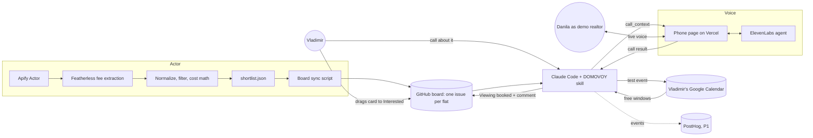
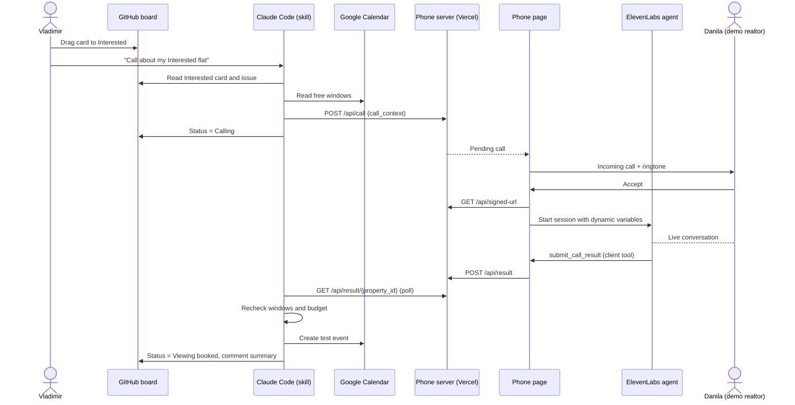

# DOMOVOY PRD

Status: draft, 13 Nov 2026. Nothing here is built yet. This folder is the build spec; [plan.md](../plan.md) holds the shared contracts, [decisions.md](../decisions.md) the decisions, [open-items.md](../open-items.md) what is undecided.

## Goal

By 18:00 on 13 Nov 2026, show one complete job live in three minutes: Vladimir's real flat search produces a shortlist, he approves one flat, an agent holds a live voice conversation about it, and a viewing appears in his calendar.

**User:** Vladimir, a real renter looking for a flat in Prague. **Product:** an open-source Agent Skill for Claude Code, not a new app.

## Lanes

| Lane | Doc | Owner | Priority | Delivers |
| --- | --- | --- | --- | --- |
| Actor | [actor.md](actor.md) | Vladimir | P0 | Real listings with costs, published as cards on the GitHub board |
| Voice | [voice.md](voice.md) | Danila | P0 | Phone page, ElevenLabs agent, call API |
| Skill | [skill.md](skill.md) | Both | P0 | `SKILL.md` that runs the whole flow, calendar, receipt |
| PostHog | [posthog.md](posthog.md) | Danila | P1 | Rejection report, approved criteria change, rerank |

Each lane doc has the same sections: definition of done, diagram, details, decisions, open items.

## How it works

## Interfaces between lanes

| From → To | Interface | Defined in |
| --- | --- | --- |
| Actor → board | `shortlist.json` → issues and cards | [actor.md](actor.md) |
| Board → Skill | `Status`, `Reason` fields; issue body with `property_id` | [plan.md](../plan.md#github-board) |
| Skill → Voice | `POST /api/call` with `call_context` | [voice.md](voice.md), [plan.md](../plan.md#contracts) |
| Voice → Skill | `GET /api/result/{property_id}` returning `submit_call_result` | [voice.md](voice.md), [plan.md](../plan.md#contracts) |
| Skill, Actor → PostHog | Events with `property_id` | [posthog.md](posthog.md) |

Change a contract only in `plan.md`, and tell the other lane.

## Definition of done

The product is done when all of this is true on Vladimir's laptop, live:

- [ ] The board shows at least 3 real flats from at least one portal, each with source link, collection time, monthly total, upfront cash and unknowns.
- [ ] Vladimir drags one card to Interested and tells Claude Code to call; nothing contacts anyone before that.
- [ ] The phone page rings, Danila answers, and the agent holds an unscripted English conversation about that flat.
- [ ] After the call, a test event at the agreed time is in Vladimir's calendar, the card is in Viewing booked, and the issue has the call summary.
- [ ] The full flow fits in 1:30 and has been rehearsed twice in the venue.
- [ ] The repo README has run instructions and what was built today; the repo is public; the Vercel URL works.

P1, only after the above: the PostHog report and rerank in [posthog.md](posthog.md).

## Checkpoints

| Time | Must be true | Cut first if not |
| --- | --- | --- |
| 14:00 | Actor: real cards on the board. Voice: page rings and agent talks with a hand-written context. | Extra portals, in-call visuals |
| 16:00 | One full run end to end: card → call → Calendar event → Viewing booked. | PostHog, Gmail |
| 17:00 | Code freeze. Dry run in the hall. 60–90 s cut rehearsed. | Any new code |
| 17:30 | Issues checked for contacts, repo public, links on the form. | — |
| 18:00 | Demo. | — |

## Out of scope

Notion, Czech, negotiation of alternative times or costs, more than one call, real phone calls, a custom dashboard, always-on monitoring, an agency product, Gmail unless time remains. Full list in [plan.md](../plan.md#scope-and-ownership).
