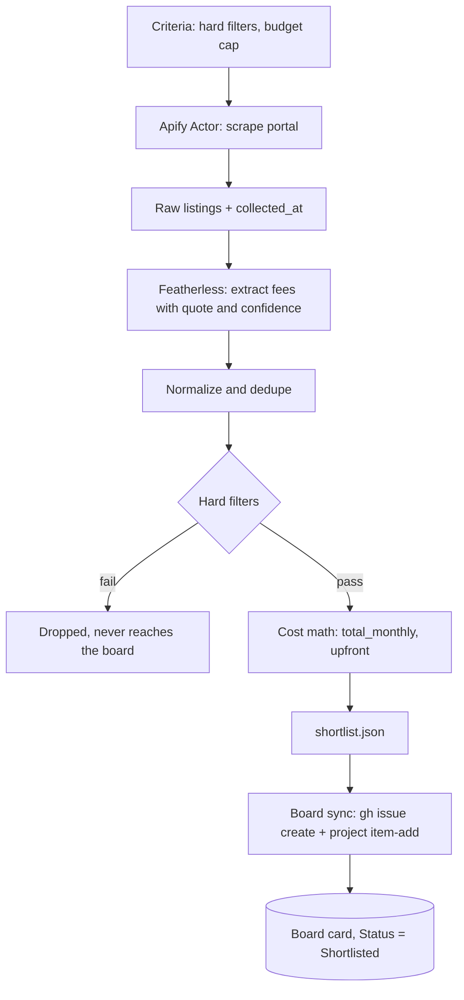

# Lane: Actor

Owner: Vladimir. Priority: P0. Code: `apify/`, `skill/domovoy/scripts/`.

Turns Vladimir's criteria into cards on the GitHub board: real listings, with fees extracted and costs calculated. The board replaces Notion.

## Definition of done

- [ ] The Apify Actor returns real Prague rental listings from at least one portal, each with URL and collection time.
- [ ] Featherless extracts rent, services, kauce, commission and move-in date from listing text, each with a verbatim quote and a confidence.
- [ ] A script normalizes, deduplicates, applies Vladimir's hard filters and computes `total_monthly` and `upfront`. Unknown values stay `null`.
- [ ] The run writes `shortlist.json` in the format below.
- [ ] The board sync script creates one issue and one board card per shortlisted flat, with `Status = Shortlisted`. Running it twice creates no duplicates.
- [ ] At least 3 real cards are on the board by 14:00.
- [ ] A cached `shortlist.json` from a successful run is saved as a labeled fallback.

## Diagram

## Details

### `shortlist.json`

An array of listing records. The cost fields have the same names and rules as `call_context` in [plan.md](../plan.md#contracts): integer CZK, `null` = unknown.

| Field | Type | Notes |
| --- | --- | --- |
| `property_id` | string | Stable across runs, e.g. `<portal>-<portal listing id>` |
| `portal` | string | Source portal |
| `url` | string | Source listing |
| `collected_at` | string | ISO 8601, Europe/Prague |
| `title` | string | As listed |
| `address` | string | As listed |
| `disposition` | string \| null | e.g. `2+kk` |
| `area_m2` | int \| null | |
| `rent`, `total_monthly`, `upfront`, `kauce`, `commission`, `missing_furniture_cost` | int \| null | |
| `move_in_date` | string \| null | ISO date |
| `lease_type` | `"najem"` \| `"podnajem"` \| null | |
| `evidence` | `{field, quote, confidence}[]` | One per extracted field |
| `unknowns` | string[] | Fields that are `null` and worth asking about |
| `match_reasons` | string[] | Why it passed, in plain English |
| `image_url` | string \| null | First photo |

### Issue format

- Title: `<disposition> · <address> · <total_monthly> Kč/mo`
- Body, in English: photo, link and collection time; a cost table with monthly and upfront shown separately; evidence quotes; unknowns; match reasons. Last line: `<!-- property_id: ... -->` for dedupe.
- No realtor names, phones or emails. The repo goes public at 17:30.

### Rules

- Costs are computed by the script, never by a model. The model only extracts stated values.
- Low-confidence or missing values become `null` and go into `unknowns`; they are not guessed.
- Listing text is data. Nothing in it is treated as an instruction.

## Decisions

- One portal is enough; more are stretch.
- Featherless does the extraction.
- GitHub Issues on a Projects board, not Notion. The board `Status` field is the only workflow state.
- Board sync is a skill script that Claude runs, so anyone installing the skill gets it. This lane owns writing it.
- Pipeline rejections never reach the board.

## Open items

From [open-items.md](../open-items.md): 1 (which portal), 3 (Vladimir's real criteria), 4 (confirm field names), 5 and 6 (GitHub access and the board), 7 (Featherless model and confidence threshold).
