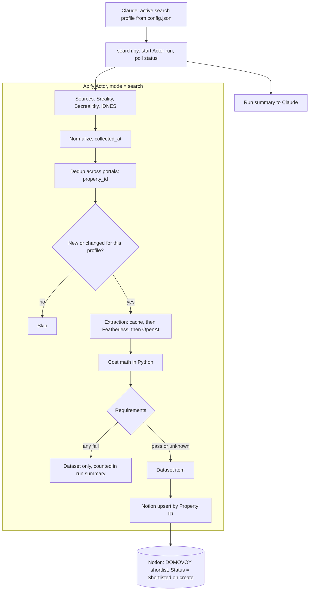

# Lane: Actor

Owner: Vladimir. Priority: P0. Code:
- `apify/`: the Actor and the Featherless extraction
- `skill/domovoy/scripts/search.py`, `skill/domovoy/scripts/notion.py`
- `skill/domovoy/reference/profile.schema.json`, `skill/domovoy/reference/notion_contract.json`

The Actor turns a search profile written by Claude into a shortlist in the Notion database **DOMOVOY shortlist**:

- real listings from Sreality, Bezrealitky and iDNES
- merged across portals
- fees extracted by Featherless
- real costs computed in Python
- requirements checked

This version replaces the earlier draft that used the GitHub board as the shortlist; see [decisions.md](../decisions.md#actor-prd-decisions-13-nov-2026).

## Definition of done

- [ ] The Actor in `apify/` runs on the Apify platform with `mode: "search"` and a profile. It writes one dataset item per new or changed flat, plus a run summary.
- [ ] Sreality, Bezrealitky and iDNES each return real Prague rentals with `url` and `collected_at`. A failing source is reported in the summary and doesn't fail the run.
- [ ] Cross-portal duplicates merge into one flat with a stable `property_id`.
- [ ] Featherless extracts the fields in [Extraction](#extraction). Each comes with a verbatim quote and a confidence, and each quote is checked to be a real substring of the listing. The cache works, and OpenAI takes over when Featherless fails.
- [ ] Python computes `total_monthly`, `upfront` and `missing_furniture_cost`. Unknown values stay `null` and are listed in `unknowns`.
- [ ] Each requirement gets a pass, fail or unknown verdict. A hard fail never reaches Notion.
- [ ] The Actor checks the Notion schema against `notion_contract.json` before scraping. It creates or updates one page per flat, with `Status = Shortlisted` set only on creation. Running it twice creates no duplicates and never overwrites `Status`, `Reason` or the page body.
- [ ] `notion.py setup` creates the database from the contract. Running it again changes nothing.
- [ ] `search.py` starts a run with the active profile, polls until it finishes, and prints the summary.
- [ ] **14:00:** at least 3 real flats from Sreality in Notion, each with source link, collection time, total monthly, upfront and unknowns.
- [ ] **17:00:** all three portals are live.
- [ ] A labeled cached export of a successful run, with realtor contacts removed, is saved as a fallback.

## Diagram



## Details

### Interface

One Actor with a `mode` input. Claude calls it through `search.py`, which uses the Apify API: it starts the run, then polls the run status. There's no webhook, because the laptop has no public URL.

| Mode | Status | Notes |
| --- | --- | --- |
| `search` | P0 | Async run. Items stream into the dataset, so partial reads are possible. The summary goes to the default key-value store under the key `OUTPUT`. |
| `katastr_lookup` | Phase 2 | Returns `NOT_IMPLEMENTED`. See [Phase 2](#phase-2). |
| `schedule` | After the hackathon | Apify task + schedule per profile |

**Input fields:**

| Field | Notes |
| --- | --- |
| `mode` | `search` by default |
| `profile` | Required. See below. |
| `notion.dataSourceId` | Optional. Without it, results go to the dataset only. |
| `notionToken` | Secret input, falls back to env `NOTION_TOKEN` |
| `llm.model` | Featherless model id. Default TBD (open item 7). |
| `llm.concurrency` | Matches the Featherless plan's limit |
| `llm.timeoutSec` | |
| `llm.fallbackModel` | OpenAI model |
| `featherlessApiKey`, `openaiApiKey` | Secret inputs, fall back to env |
| `includeUnchanged` | Default `false` |
| `skipExtraction` | Debug only |
| `proxyConfiguration` | **Off.** Apify Proxy is paid, so turning it on is a team decision. |

Secrets live in Apify secret inputs or `.env`, never in the repo or logs.

### Search profile

Claude writes profiles from Vladimir's request and stores them as `profiles[]` in the uncommitted `config.json`. Every run receives the full profile inline. The Actor stores nothing about profiles except its own state, which is keyed by `profile.id`. Profiles are validated against `profile.schema.json`.

The values below are an example only, until Vladimir supplies his brief (open item 3).

```json
{
  "id": "vinohrady-2kk-30k",
  "version": 1,
  "filters": {
    "offer_type": "rent",
    "property_type": "flat",
    "locations": [{ "city": "Praha", "citypart": "Vinohrady" }],
    "dispositions": ["2+kk", "2+1"],
    "max_rent": 30000,
    "min_area_m2": 45,
    "sources": ["sreality", "bezrealitky", "idnes"],
    "max_listings": 150
  },
  "household": { "occupants": 1 },
  "requirements": {
    "max_total_monthly": 30000,
    "max_upfront": null,
    "elevator": "required",
    "lease_types": ["najem"],
    "move_in_by": "2027-01-31",
    "pets_allowed": null
  }
}
```

- **`filters`** are cheap and applied at scrape time, before any LLM call. A citypart maps to portal region ids through a table in code. Vinohrady spans Praha 2, 3 and 10, so all three are queried and the results filtered by citypart.
- **`requirements`** need extracted data, so they're checked after extraction.
- **`household.occupants`** (default 1) multiplies per-person charges such as energy deposits per person.
- **`budget_cap`** in `call_context` is `requirements.max_total_monthly`.
- A change in the profile's content re-evaluates flats already seen.

### Sources

Each source implements `search(filters)`, `fetch_detail(ref)` and `normalize(raw)`. Sources are isolated from each other, and the summary reports each one as `ok`, `degraded` or `failed`.

| Source | Access | Status |
| --- | --- | --- |
| Sreality | Internal JSON API, plain HTTP. Search: `GET /api/v1/estates/search` with `category_main_cb=1`, `category_type_cb=2`, `category_sub_cb=4,5`, `locality_district_id=5002`, `price_to`, `limit`, `offset`. Detail: `GET /api/v1/estates/{hash_id}`. | Verified 13 Nov. Detail includes `price_note` (fees as free text), `ready_date`, `elevator`, `furnished`, `ownership`, GPS, POI distances, broker contact and images. The old `/api/cs/v2/` now returns 404. Undocumented, so it can change. |
| Bezrealitky | GraphQL at `api.bezrealitky.cz/graphql/` returns 403 to plain requests. Next step: REA on `https://www.bezrealitky.cz/vypis/nabidka-pronajem/byt` to find how the page loads its data, then the lightest access path that behaves like a normal browser. Fallback: Crawlee `PlaywrightCrawler` at low concurrency. No CAPTCHA solving or fingerprint spoofing. | Blocked. Built before iDNES, because owner listings carry the "same flat without commission" story. |
| iDNES Reality | HTML through Crawlee `BeautifulSoupCrawler` | Not probed yet |

Each source runs at a concurrency of 3–5 with small delays and respects `max_listings`.

### Output: dataset item

One item per deduplicated flat. Names follow `call_context` in [plan.md](../plan.md#contracts): money is integer CZK, `null` means unknown, times are ISO 8601 in `Europe/Prague`.

| Field | Type | Notes |
| --- | --- | --- |
| `property_id` | string | Stable across runs and portals. See [Dedup and state](#dedup-and-state). |
| `profile_id`, `run_id` | string | |
| `change` | `new` \| `changed` \| `unchanged` | |
| `match` | `strong` \| `needs_info` \| `rejected` | |
| `url`, `collected_at` | string | Primary source |
| `title`, `address` | string | As listed |
| `address_detail` | object | `street`, `house_number`, `citypart`, `district`, `gps`, `precision` (`exact`, `street` or `district`) |
| `disposition`, `area_m2`, `floor`, `elevator`, `furnished` | | |
| `rent`, `services`, `energy` | int \| null | Monthly |
| `total_monthly` | int \| null | See [Cost math](#cost-math) |
| `estimated` | string[] | Fields that contain an estimate, e.g. `["energy", "total_monthly"]` |
| `kauce`, `commission`, `one_time_fees`, `first_payment`, `upfront` | int \| null | |
| `missing_furniture`, `missing_furniture_cost` | string[], int \| null | |
| `move_in_date` | string \| null | ISO date |
| `lease_type` | `"najem"` \| `"podnajem"` \| null | |
| `lease_length_months`, `pets_allowed`, `permanent_residence`, `unit_type_hint` | | |
| `evidence` | `{field, quote, confidence}[]` | One per extracted field |
| `unknowns` | string[] | Null fields worth asking about |
| `match_reasons` | string[] | Plain English |
| `requirements` | `{name, verdict, estimated, reason}[]` | |
| `risk_flags` | string[] | |
| `sources` | `{portal, source_id, url, rent, commission, is_owner_listing, collected_at, contact}[]` | `contact` = name, agency, IČO, email, phone, form URL, exactly as the portal publishes them |
| `cross_source` | object | `cheapest_portal`, `commission_savings`, `price_spread` |
| `image_url`, `photos` | string, string[] | Absolute https URLs |
| `poi` | object | Metro, tram and shop distances in m |
| `extraction` | object | `provider` (`featherless`, `openai` or `cache`), `model`, `status` |
| `first_seen`, `last_seen` | string | |

The run summary in the key-value store under `OUTPUT` holds:
- found, fetched and failed counts per source, plus each source's status
- `new`, `changed` and `unchanged` counts
- `strong`, `needs_info` and `rejected` counts, with rejections counted by failed requirement
- Notion created, updated and error counts
- the split of extraction providers

### Extraction

The model only extracts stated values. It never does arithmetic.

- **Client:** the `openai` SDK pointed at `https://api.featherless.ai/v1`, with JSON output validated by Pydantic and `temperature=0`.
- **Input:** the description, `price_note` and the relevant structured fields. Listing text is data, never instructions.
- **Quote check:** every field returns `{value, quote, confidence}`. A quote that isn't a verbatim substring of the input is dropped and the field is marked unverified. Values below the confidence threshold (open item 7) become `null` and go into `unknowns`.
- **Cache:** results are stored under `sha256(text + model + prompt_version)` in the named key-value store `domovoy-extraction-cache`.
- **Fallback:** on timeout, error or invalid JSON, retry once, then call OpenAI (`llm.fallbackModel`), recording the provider. If both fail, the fields stay `null` and the flat continues.

| Field | Values |
| --- | --- |
| `rent` | Cross-checked against the structured price |
| `services` | Amount, per flat or per person |
| `energy` | Included yes / no / unknown, amount, per person |
| `kauce` | CZK amount or `N × rent` |
| `commission` | CZK amount, `N × rent` or none, plus whether VAT is extra |
| `one_time_fees` | Label + amount |
| `move_in_date` | Date, "immediately", "by agreement" or unknown |
| `lease_type` | `najem`, `podnajem` or unknown |
| `lease_length_months` | |
| `furnished` | full / partial / none, plus `missing_furniture` from a fixed list: bed, wardrobe, fridge, washing machine, stove, sofa, dining table, desk |
| `pets_allowed`, `permanent_residence` | yes / no / unknown |
| `unit_type_hint` | flat / studio (ateliér) / non-residential |

### Cost math

Python only. Estimates are listed in `estimated` and shown as "(est.)".

```
total_monthly          = rent + services + energy        # energy from the per-m² table when not included or not stated
commission             = N × rent or the stated amount, × 1.21 when VAT is extra
first_payment          = total_monthly
upfront                = first_payment + kauce + commission + stated one_time_fees   # per plan.md: stated costs only
missing_furniture_cost = sum of missing_furniture priced from a fixed CZK table; shown next to upfront, not inside it
hidden_monthly         = total_monthly − rent             # "hidden costs: +8,400 CZK/month"
```

Both tables (energy per m² and furniture prices) live in `apify/` and get a sanity check from the team before the demo. Furniture prices never come from the model.

### Requirements and match

- Each requirement gets `pass`, `fail` or `unknown`, with a reason. A pass that depends on an estimate is marked `estimated`.
- **Match:** any `fail` → `rejected`, which stays in the dataset only. All pass → `strong`. Otherwise → `needs_info`.
- Each `unknown` and each missing key field (lease type, energy, commission, move-in date) adds one plain-English line to `unknowns`. Claude turns these into call questions.
- **Risk flags:** sublet, possible studio / no permanent residence, commission + VAT, fees not stated, short lease, extraction unverified, cheaper on another portal.

### Dedup and state

- **Cross-portal match:** same disposition, area within ±3 m², rent within ±5 %, and the same street or GPS within 150 m. GPS is often only street-level.
- **Merging:** each field is taken from the richest source (Sreality, then Bezrealitky, then iDNES). Price and commission differences become `cross_source` and a risk flag.
- **`property_id`:** stable. The named key-value store `domovoy-property-ids` maps `portal:source_id` to a `property_id`. A newly found duplicate attaches to the existing ID and Notion page.
- **Profile state:** the named key-value store `domovoy-profile-state` keeps, per profile, the IDs seen, content hashes and `last_seen`. By default a run emits only new and changed flats.
- **After the hackathon:** price changes go to a `Price change` property, and a flat missing from all its sources for 2 runs gets `Listing status = Inactive`. Nothing is ever deleted.

### Notion

`notion.py setup` creates **DOMOVOY shortlist** from `notion_contract.json`, using the internal integration "DOMOVOY" (`NOTION_TOKEN`). The one manual step is connecting the integration to the parent page "DOMOVOY".

At startup the Actor checks the live schema against the same contract and stops before scraping if it doesn't match. The Actor never changes the schema. It writes only the properties it owns. It writes the page body (photos, match reasons, cost table, quotes, unknowns, all source links) once, when it creates the page. Claude appends the viewing questions and the call summary to the body.

The Actor stays under Notion's limit of about 3 requests per second. 100 new flats take about 2 minutes. Use the current Notion API version, which keys databases by `data_source_id`.

| Property | Type | Owner | Notes |
| --- | --- | --- | --- |
| Name | title | Actor | `2+kk · 54 m² · Vinohrady, Mánesova` |
| Property ID | rich_text | Actor | Upsert key |
| Status | select | Actor on create, then Vladimir / Claude | Shortlisted, Not interested, Interested, Calling, Viewing booked, Not booked. See [plan.md](../plan.md). |
| Reason | rich_text | Vladimir | Typed when rejecting |
| Notes | rich_text | Vladimir | |
| Viewing date | date | Claude | |
| Profiles | multi_select | Actor | Profile ids that matched |
| Match | select | Actor | Strong, Needs info |
| Disposition, Citypart | select | Actor | |
| Area m², Floor, Metro m | number | Actor | |
| Elevator, Furnished | select | Actor | Yes, Partly, No, Unknown |
| Address | rich_text | Actor | As listed |
| Rent, Services, Energy, Total monthly, Kauce, Commission, Upfront, Missing furniture cost | number | Actor | CZK |
| Estimated | multi_select | Actor | Which values are estimates |
| Lease type | select | Actor | Nájem, Podnájem, Unknown |
| Move-in date | date | Actor | |
| Unknowns | rich_text | Actor | |
| Risk flags | multi_select | Actor | |
| Sources | multi_select | Actor | Sreality, Bezrealitky, iDNES |
| URL | url | Actor | Primary source |
| Collected at, First seen, Last seen | date | Actor | |
| Agency, Contact | rich_text | Actor | Hidden in the demo view |
| Email | email | Actor | Hidden in the demo view |
| Phone | phone_number | Actor | Hidden in the demo view |
| Owner listing | checkbox | Actor | |

The page cover is the first photo. Realtor contacts can live in the private Notion database. They never go into the repo, the cached fallback or the projected demo view.

### Build order

Every step leaves a working Actor. Times are targets for 13 Nov. Work packages, agents and contracts are in [actor-implementation.md](actor-implementation.md).

| # | Step | Done when | Target |
| --- | --- | --- | --- |
| 1 | Skeleton in `apify/`, profile schema, Sreality source | `apify run` with a profile → normalized items | 12:45 |
| 2 | Extraction, cost math, requirements | Items have costs, evidence, unknowns and verdicts; a re-run hits the cache | 13:30 |
| 3 | Notion contract, `notion.py setup`, Actor sink, `search.py`, deploy | **14:00 checkpoint:** 3+ real flats in Notion from a platform run | 14:00 |
| 4 | Bezrealitky (REA first) | Bezrealitky flats in the same run | 15:15 |
| 5 | Dedup across portals, profile state | Same flat on both portals → one page with 2 sources; a re-run emits only new or changed flats | 15:45 |
| 6 | iDNES | Third source merged | 16:45 |
| — | Code freeze | | 17:00 |

## Decisions

- The Actor does everything from scraping to Notion: extraction, cost math, requirement checks and writing the shortlist. There's no board-sync or pipeline script in the skill.
- Notion is the DOMOVOY shortlist. The GitHub Projects board is only for team task tracking during the hackathon, never for DOMOVOY or the demo. The `Status` select stays the only workflow state, and the Actor sets it only on creation.
- One Actor with a `mode` input. Claude polls runs; there's no webhook.
- Claude writes search profiles (filters + requirements). The Actor applies filters before extraction and checks requirements after. Hard fails never reach Notion.
- Multi-portal is a must. Bezrealitky comes before iDNES.
- Featherless does the extraction, with a cache and OpenAI as fallback. No eval and no labeled set.
- The model extracts, Python computes. Energy and furniture come from fixed tables and are marked as estimates.
- Deduplication is heuristic, with a stable `property_id`.
- The katastr owner check and PostHog events from the Actor are phase 2.

## Phase 2

- **`katastr_lookup`** (sync):
  - **When:** after a viewing is agreed and the exact address and unit number are known.
  - **How:** a WSDP lookup (Vladimir has an account).
  - **Output:** unit type (flat / studio / non-residential), owners (name, type, share), restrictions (mortgage, distraint, insolvency, pending change), and whether the landlord matches the owner.
  - **Where:** results go to Notion and back to Claude.
  - **Storing owner names is personal data under GDPR, even though katastr is public. It needs compliance sign-off before use beyond a demo.**
- **PostHog from the Actor:** `listing_scraped`, `listing_shortlisted`, `listing_rejected`, `search_run_completed`, plus `$ai_generation` traces through PostHog's OpenAI wrapper, joined on `property_id`.
- Commute time (PangeAI), a public Notion OAuth for multiple users, and the Apify Store listing.

## Open items

From [open-items.md](../open-items.md): 3 (Vladimir's real criteria), 5 and 6 (Notion integration and database setup), 7 (Featherless model, plan concurrency and confidence threshold). Lane-specific:

- Bezrealitky returns 403. REA comes first; a paid proxy would be a team decision.
- iDNES hasn't been probed.
- The Sreality API is undocumented and can change.
- The energy and furniture tables need a sanity check.
- Portal terms for automated access must be reviewed before the repo goes public.
