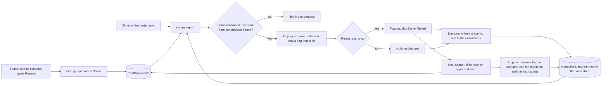

# Lane: PostHog

Owner: Danila. Priority: P1. Code: `posthog/`.

Optional self-improvement loop. DOMOVOY sends what happens to PostHog; Claude reads it back, finds one pattern, proposes one change, applies it only after Vladimir says yes, and then measures whether the change held.

## Summary: the self-improvement loop

| Step | What happens | Command | PostHog feature |
| --- | --- | --- | --- |
| 1 Record | Flats shown, rejected with a typed reason, liked or filtered become events | `loop.py sync` | Events |
| 2 Notice | Claude reads the rejections and its own instructions, and groups the free-text reasons by a short key | `loop.py report` | Query API, skills store |
| 3 Ask | One reason on 3 or more flats becomes one suggestion: a notebook and a switch that is off | `loop.py propose` | Notebook, feature flag |
| 4 Change | On a yes the switch goes on and flats that break the rule leave the shortlist. After every later search the rule is applied again | `loop.py decide`, `loop.py apply` | Feature flag |
| 5 Remember | Each decision is appended to the agent's instructions as a new version; a decided reason is never proposed again | inside `decide` | Skills store, events |
| 6 Measure | Flats that break the rule and still reached the renter, before and after; the result goes into the notebook and the instructions | `loop.py measure` | Events, notebook |

- **Trigger:** the renter asks, or the local timer `posthog/schedule.py` runs. See [Who starts the loop](#who-starts-the-loop).
- **Human control:** nothing changes without a yes. The timer can only propose.
- **Why PostHog and not only Notion:** Notion holds the current list. PostHog holds the history a before and after needs, every version of the agent's instructions, and a record the agent does not edit. Call traces with a score per prompt version live there too (`posthog/calls.py`).
- **Not built:** a suggestion for the voice prompt from call scores, and anything across more than one renter.

## Definition of done (state on 13 Nov 2026)

- [x] `loop.py sync` sends the events below from the Notion shortlist, each with `property_id`. Events sent from inside the Actor are phase 2.
- [x] `loop.py report` reads today's `listing_rejected` events from PostHog; Claude groups them into one finding with its evidence.
- [x] Claude proposes one specific criteria change and waits for a yes or no.
- [x] On yes, the change is switched on as a PostHog feature flag whose payload holds the requirement, and the shortlist is re-filtered. The research command applies approved rules after each search; `search.py` itself does not read them (issue #43).
- [x] The decision is recorded as an event and in the stored instructions, so the same proposal is not made twice.
- [x] `loop.py measure` writes a before and after into the notebook.
- [x] `posthog/schedule.py` runs the loop on a timer and only proposes.
- [ ] Run on the real shortlist. Every box above was checked on synthetic flats only: [posthog/README.md](../../posthog/README.md).
- [ ] The stage step fits in 60 seconds. Measured machine time is about 14 s; see [Stage timing](#stage-timing). Not rehearsed.

## Diagram

## Details

### Events

`distinct_id` is the renter's first name from config. Every event carries `property_id` where one applies, plus `portal` and `run_id`.

| Event | Sent when | Extra properties |
| --- | --- | --- |
| `listing_shortlisted` | `search.py` sees a new page in the Actor run summary | `total_monthly`, `upfront` |
| `listing_rejected` | Card is in Not interested with a `Reason` | `reason` |
| `listing_interested` | Card moved to Interested | |
| `listing_filtered` | Agent moved a shown card to Not interested for an approved rule (`Reason` starts with `filtered:`) | `reason` |
| `call_started` | Context posted | |
| `call_finished` | Result handled | `outcome`, `new_costs_count` |
| `extraction_low_confidence` | Featherless confidence under the threshold (phase 2: sent from the Actor) | `field`, `confidence` |
| `criteria_change_decided` | Vladimir answers a proposal | `change`, `approved` |

Required for the demo: `listing_rejected` and `criteria_change_decided`. The rest are sent if the code path exists.

Notion changes carry no event of their own, so the skill reads Notion and sends `listing_rejected` for each rejected flat it has not sent before.

### Report and change

- Reasons are free text. Claude normalizes them to a short key, e.g. "no lift", "without elevator" → `no_elevator`, before grouping.
- A proposal needs one reason on 3 or more rejections. With fewer, the report says so and proposes nothing.
- A change adds one requirement, held by a feature flag. Flats that now fail are moved to Not interested with `Reason = filtered: <change>`; the remaining flats keep their order by `total_monthly`. Supported today: `elevator` required, `max_total_monthly`, `max_upfront`.
- The chosen reason must not already be a hard filter, or those flats would never have reached Notion.

### How it runs on the free plan

PostHog's own scouts and Inbox are paid: on 13 Nov 2026 the free plan gave them 0 credits, a scout run returned 429 and filing an Inbox report returned 402. The loop uses only free features, through `posthog/loop.py`:

| Step | PostHog feature |
| --- | --- |
| Signals: `loop.py sync` | Events |
| Scout instructions, read by Claude at `loop.py report` | Skills store (`domovoy-rejections`, versioned) |
| Report: `loop.py propose` | Notebook "DOMOVOY suggests: ...": status line, the renter's words next to what the agent understood, the suggestion, the flag switch, and what happened next |
| Yes or no: `loop.py decide` | Feature flag `domovoy-criteria-<key>`: off = proposed or declined, on = approved |
| Memory | `criteria_change_decided` events, plus each decision appended to the stored instructions as a new version |
| Apply after a search: `loop.py apply` | Flats that break an approved rule are moved to Not interested and sent as `listing_filtered` events |
| Measure: `loop.py measure` | Per approved change, flats that break its rule and still reach the renter, before and after. The result goes into the notebook and the stored instructions |
| On a timer: `posthog/schedule.py` | Runs sync and measure every 10 minutes, and wakes Claude only when 3 or more rejections are new |

Commands and test evidence: [posthog/README.md](../../posthog/README.md). Claude's steps: the improve command in `skill/domovoy/SKILL.md`.

### Who starts the loop

Two ways, both end at the same question to the renter:

- **Asked:** the renter says "improve my search" and Claude runs the improve command.
- **On a timer:** `python3 posthog/schedule.py install` adds a macOS launchd job. Every 10 minutes a tick runs `sync` and `measure`. Only when 3 or more renter rejections are new, it starts a headless Claude that may run `loop.py report` and `loop.py propose` and nothing else. So the timer can file a suggestion (flag off, notebook) and a macOS notification, and can never answer the suggestion or write to Notion. `status` shows the last runs, `remove` stops it.

The timer is local to one Mac and is not installed by default. It is not the always-on monitoring that [plan.md](../plan.md) rules out.

### Stage timing

PostHog shows a new event to queries 30 to 100 s after it is sent. That wait must happen before the PostHog minute, not in it.

- Before: `loop.py sync` runs when Vladimir has rejected flats, and again in the background at the start of the call command, so ingestion happens during the voice call.
- On stage: `report`, `propose`, `decide`. Measured on the synthetic Notion test database with events already ingested: 3.3 s, 6.9 s and 3.6 s, 13.8 s in total. Claude's own reading and Vladimir's yes come on top.
- If the events are not in yet, `report` waits (at most 150 s) and says so. It never reports from a local log; a report is either complete from PostHog or marked `"complete": false`.

### Honesty

- `measure` shows that an approved rule holds: flats that break it stop reaching the renter. It does not show that the renter is happier. Say that, and say "small sample".
- The timer was run by hand on synthetic data on 13 Nov 2026 (one tick, one proposal). A tick fired by launchd itself and a run on the real shortlist were not done.
- No local event log backs the report today. If the venue network fails, there is no PostHog step; say so.
- Do not claim PostHog's native self-driving Inbox, scouts, session replay or agency customers. Say: "PostHog's own scouts are a paid feature, so our agent runs the same loop on PostHog's free parts." Agencies get one spoken sentence.
- PostHog holds telemetry only. Listing facts stay in Notion pages, state in the Notion `Status`.

## Decisions

- P1, after the core.
- The demo signal is rejections with a reason, typed in the Notion `Reason` property.
- Approval for a criteria change is separate from Interested.
- The Featherless labeled evaluation stays deferred.

## Open items

From [open-items.md](../open-items.md): 8 (PostHog project key and the sponsor prize criteria). Workshop notes and the full signal list are in the [original lane export](../archive/2026-11-13-notion/03-lane-3-posthog-self-driving-loop-mac-mini.md).
