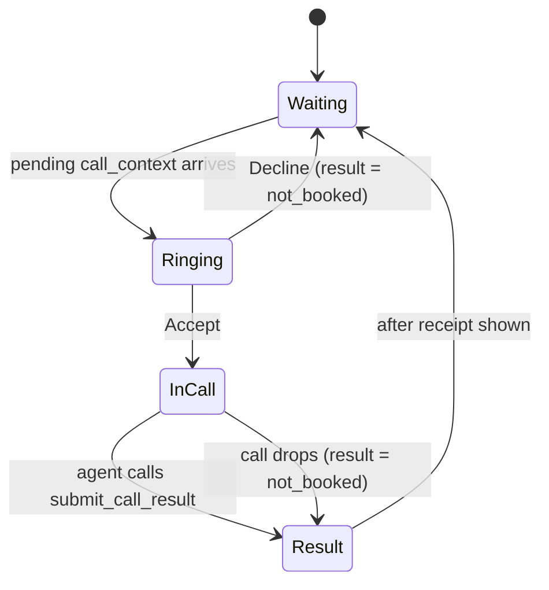
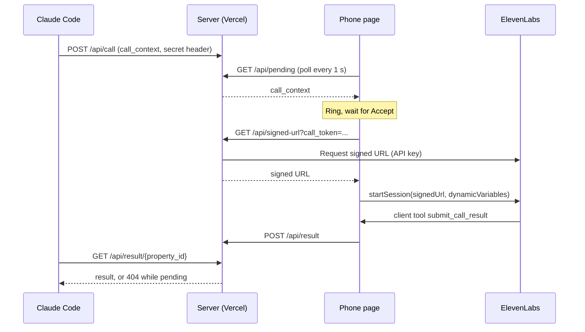

# Lane: Voice

Owner: Danila. Priority: P0. Code: `phone/`.

A phone page that waits, rings when Claude sends a flat, runs a live English conversation through an ElevenLabs agent, and hands the result back to Claude.

## Definition of done

- [ ] The phone app is deployed on Vercel at a public URL.
- [ ] `POST /api/call` with a valid `call_context` makes the open page show an incoming call with the flat's address and play the Nokia 3310 ringtone, with no click on the page.
- [ ] Accept starts a live ElevenLabs session. The agent knows the flat, the unknowns to ask about and the free windows.
- [ ] The agent asks about the unknowns, agrees a viewing time inside a free window, then calls `submit_call_result` and ends the call.
- [ ] `GET /api/result/{property_id}` returns that result to Claude.
- [ ] The ElevenLabs API key exists only on the server. The agent accepts only signed URLs (`enable_auth`), and the server issues one only for a call Claude started.
- [ ] A hand-written context works end to end by 14:00, before the Actor lane is ready.
- [ ] Rehearsed on Vladimir's laptop with the venue's audio and Wi-Fi.

## Diagram

## Details

### API

| Route | Caller | Does |
| --- | --- | --- |
| `POST /api/call` | Claude | Stores the `call_context` as the pending call and clears any stored result for its `property_id`. Rejects only a context without `property_id` or `address`; every other field passes through. Requires header `x-domovoy-secret`. |
| `GET /api/pending` | Paired page | Returns `{context, call_token}` once, then clears it; both are `null` when nothing is pending. Requires header `x-domovoy-receiver` (env `DOMOVOY_RECEIVER_KEY`), else 401. |
| `GET /api/signed-url?call_token=` | Page | Returns a short-lived ElevenLabs signed URL. Needs the one-time `call_token` from `/api/pending`, else 403. |
| `POST /api/result` | Page | Stores the result by `property_id`. A repeated `conversation_id` is ignored. |
| `GET /api/result/{property_id}` | Claude | Returns the result, or 404 while the call is running. Requires the secret header. |

Contracts for `call_context` and `submit_call_result` are in [plan.md](../plan.md#contracts).

Vercel functions share no memory, so pending calls and results need a small store. Built: Upstash Redis (free plan) from the Vercel Marketplace, behind `phone/lib/store.js`, with a 1-hour expiry on every key.

### Page

- Screens: waiting → incoming call (address, Accept / Decline, ringtone) → in call (timer, live transcript) → result (outcome and time).
- Pairing: only a paired page receives calls. Open `/?k=<DOMOVOY_RECEIVER_KEY>` once on the demo laptop (or `/start?k=`); the page keeps the key in localStorage and removes it from the address bar. A page without the key is public and viewable, shows "Demo phone. Calls ring only on the paired device.", never polls and never rings.
- Browsers block audio until the user interacts with a page. The waiting screen needs one "Ready" click before the demo so the ringtone can play later.
- Ringtone: an mp3 cut from the referenced Nokia 3310 video.

### ElevenLabs agent

- Created from `phone/agent/` with `sync-agent.mjs`. Auth: signed URLs only, no allowlist, because the ElevenLabs auth guide says not to configure both on one agent.
- English. Client tools: `submit_call_result` (the result), `mark_question_asked` (display only: ticks an open question on the page, changes no data), plus the built-in end-call. No other tools.
- Tone: dry, warm humour about being an AI; the job comes first. The voice is picked in the ElevenLabs dashboard; `sync-agent.mjs` never overwrites it on update.
- Dynamic variables: the `call_context` fields. `available_windows` and `unknowns` are passed as readable text, and `context_text` carries every field as `key: value` lines. The prompt names only `user_name`, `realtor_name`, `address`, `unknowns`, `available_windows` and `context_text`, so other fields can be renamed without touching the agent.
- The page adds `property_id` and `conversation_id` to the result; the agent does not pass them.
- Prompt rules: say it is an AI assistant calling for the renter; ask each unknown once; propose times only from the free windows; confirm the agreed time back before saving; call `submit_call_result` exactly once; never agree to payments or anything beyond a viewing.
- `outcome` is `booked` only after the realtor explicitly agrees to a time inside a window. Anything else is `not_booked`.

## Decisions

- Browser WebRTC, no Twilio, no real phone number. Said plainly on stage.
- English only. One call per demo. Happy path only; no negotiation.
- Vercel for both the demo and the submission link.
- Result relay: ElevenLabs client tool → page → server → Claude polls.
- Danila plays the demo realtor on Vladimir's laptop.

## Open items

From [open-items.md](../open-items.md): 9 (voice and persona are first picks, to be judged in the spoken rehearsal; the agent exists and the allowlist is not used). Settled for this lane: the store choice above; `x-domovoy-secret`, `PHONE_URL` and `ELEVENLABS_AGENT_ID` live in the shared local env file outside the repo.
